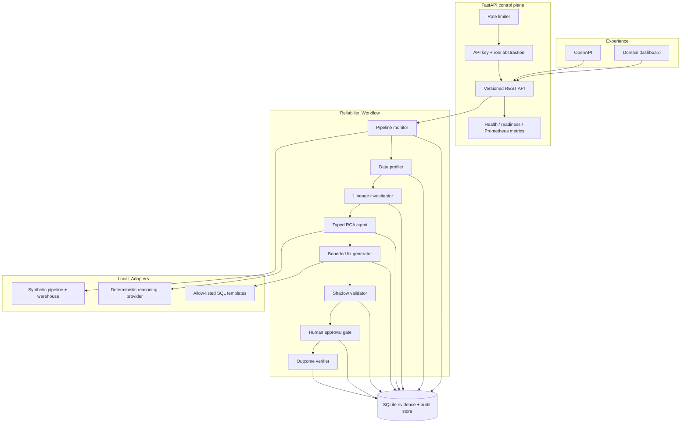
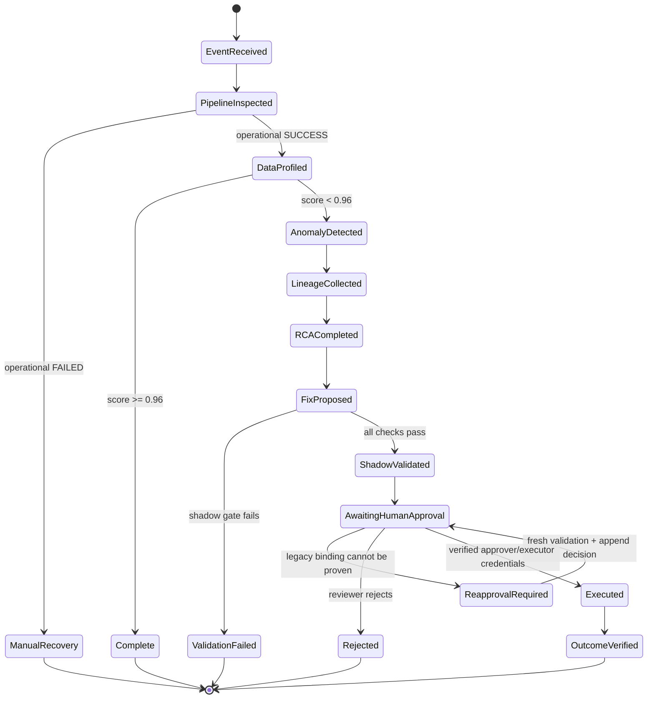

# Architecture

## System architecture



## Agent workflow



## Validation workflow

```mermaid
sequenceDiagram
  participant A as Fix Generation Agent
  participant P as SQL Policy
  participant S as Shadow Dataset
  participant Q as 8 Quality Gates
  participant H as Human Operator
  participant D as Simulated Deployer
  participant R as Fresh pipeline adapter run
  A->>P: proposed dbt SELECT/WITH + SHA-256
  P-->>A: allow-listed and read-only
  A->>S: apply deterministic transform
  S->>Q: before/after profiles
  Q-->>A: row count 10→8, score→1.0
  A->>H: risk, blast radius, rollback, evidence
  H->>D: explicit immutable hash-bound approval
  D->>P: verify unchanged hash and policy
  D->>R: recollect current operational state and source snapshot
  R-->>D: require operational SUCCESS; timeout/failure blocks
  D->>Q: independently rerun exact SQL on fresh source snapshot
  Q-->>H: verified score and audit event
```

## Persistence

The project-local SQLite database contains versioned migration state and domain tables
for runs, metrics, incidents, evidence, lineage, proposals, validations, approvals,
executions, evaluations, and audit events. Triggers reject audit updates/deletes and
prevent approved SQL/hash or approval binding/identity updates/deletes. A legacy
`REAPPROVAL_REQUIRED` record remains immutable history once a new approved decision is
appended. Each test receives an isolated database.

## Extension boundaries

`SyntheticPipelineAdapter` is the local implementation of the pipeline/warehouse
boundary. A production adapter can collect Airflow or Dagster run metadata and query
DuckDB, PostgreSQL, Snowflake, or BigQuery. `ReasoningProvider` isolates optional LLM
reasoning. The correctness gates remain deterministic regardless of provider.
