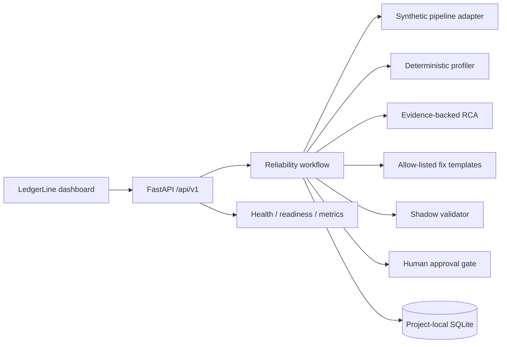

# LedgerLine — Autonomous Data Quality & Pipeline Reliability Agent

LedgerLine is a runnable local POC that proves a pipeline's operational `SUCCESS`
state is not evidence that its data is correct. It detects both execution failures
and silent logical failures, builds a typed evidence-backed root cause analysis,
generates a bounded dbt-style correction, validates it on shadow data, and blocks
deployment until a human approves it.

The default demo is fully deterministic and requires no cloud account or paid LLM.

## Problem

Traditional orchestrators primarily answer whether tasks ran. A bad join, duplicate
dimension snapshot, incorrect business transformation, or dropped partition can still
produce a green DAG and corrupt downstream KPIs. Alerts without lineage, evidence, or
validation also leave engineers to reconstruct the failure manually.

## Solution

This vertical slice includes:

- A synthetic orchestrator/warehouse adapter with healthy, operational-failure, and
  silent incorrect-join scenarios.
- Eight deterministic quality dimensions: completeness, validity, uniqueness,
  consistency, freshness, accuracy proxy, referential integrity, and business rules.
- Persisted runs, metrics, incidents, lineage, evidence, proposals, validations,
  approvals, executions, evaluations, and append-only audit history in local SQLite.
- Typed RCA and remediation contracts using Pydantic v2.
- A fixed, read-only `WITH`/`SELECT` dbt-style SQL proposal with a SHA-256 integrity
  check. No LLM or API caller can execute arbitrary shell or SQL commands.
- Exact-artifact shadow execution and an explicit credential-backed approval gate.
- Versioned FastAPI endpoints, OpenAPI, health, readiness, Prometheus text metrics,
  API-key authentication for mutations, credential-derived roles, rate limiting, and CORS allow-listing.
- A domain-specific control-room dashboard focused on lineage, quality vectors,
  evidence, proposed fixes, and approval state.

## Architecture



See [ARCHITECTURE.md](ARCHITECTURE.md) for the workflow and validation diagrams.

## Agent architecture

The implementation uses a replaceable workflow service instead of binding the POC
to one orchestration framework. Six focused agents are exposed at `/api/v1/agents`.
Every agent declares responsibility, inputs, outputs, tools, permission boundary,
and failure behavior. Deterministic software performs profiling, risk checks, and
validation. The mock reasoning provider only synthesizes evidence and can later be
replaced behind its protocol.

## Workflow

```text
pipeline event → operational inspection → deterministic profiling → anomaly
→ lineage + evidence → typed RCA → bounded SQL proposal → shadow validation
→ human approval → simulated deployment → outcome verification → evaluation
```

RCA prediction receives only persisted evidence. Simulator ground truth is stored
separately and is consulted only after prediction to score RCA accuracy. Shadow
validation renders the exact stored dbt-style proposal and executes it in a read-only
in-memory SQLite database; it does not substitute a known-correct Python transform.

The `incorrect_join` scenario deliberately joins orders to every customer snapshot.
Customer `c-002` has two snapshots, so the run reports `SUCCESS` but emits 10 rows
from 8 orders and overstates revenue. The proposed fix ranks snapshots and joins only
the latest record.

## Technology stack

- Python 3.11, FastAPI, Pydantic v2, Uvicorn
- SQLite via Python's standard library; four idempotent schema/binding migrations
- Plain HTML/CSS/JavaScript dashboard with no frontend build step
- Pytest and FastAPI TestClient
- Docker / Docker Compose

## Local installation

```powershell
cd "D:\ai apps dump\codex apps\enterprise-agentic-ai-portfolio\03-data-pipeline-reliability-agent"
python -m venv .venv
.\.venv\Scripts\Activate.ps1
python -m pip install -r requirements.txt
$env:API_KEY = "local-demo-key"
$env:API_KEY_ROLE = "admin"
$env:API_KEY_ACTOR = "local-demo-admin"
python -m uvicorn backend.app.main:app --host 0.0.0.0 --port 8103
```

Open [http://localhost:8103](http://localhost:8103). API docs are at
[http://localhost:8103/docs](http://localhost:8103/docs).

Or run:

```bash
docker compose up --build
```

SQLite data is stored in `data/reliability.db` locally or in the named Compose volume.

## Demo

Enter the configured control credential, use the dashboard's **Inject silent failure**
button, review the quality vector, evidence, RCA, SQL, and shadow score, then
approve the simulated deployment. Compose and `scripts/run.ps1` use the local-only
demo credential `local-demo-key`; change it before sharing the service. Or:

```powershell
.\scripts\demo.ps1
```

Run individual scenarios with:

```bash
curl -X POST http://localhost:8103/api/v1/demo/run \
  -H "X-API-Key: local-demo-key" \
  -H "Content-Type: application/json" \
  -d '{"scenario":"incorrect_join"}'
```

Accepted scenarios are `healthy`, `operational_failure`, and `incorrect_join`.
`POST /api/v1/demo/bootstrap` runs all three.

## Evaluation and metrics

Every workflow stores ground truth separately from the evidence-derived prediction,
then records anomaly detection, RCA correctness, false positives, MTTD, MTTR, and
quality improvement.
The overview API reports aggregate recall, RCA accuracy, false-positive rate, and
before/after improvement. `/metrics` exposes process-level request and workflow
counters in Prometheus text format. See [EVALUATION.md](EVALUATION.md).

## Security and human approval

Potential changes use `PROPOSE → RISK ASSESS → SHADOW VALIDATE → APPROVE → EXECUTE`.
The generated artifact must be read-only SQL, pass all shadow checks, preserve its
content hash, and receive a decision from a verified `approver` or `admin` credential.
The approval record is bound to that exact hash. SQLite triggers prevent an approved
proposal's SQL/hash or its approval identity/binding from being updated or deleted.
Execution requires an `executor` or
`admin` credential and independently reruns the proposal against a fresh source
snapshot before resolving the incident; a failed or unavailable fresh pipeline run
blocks deployment even if cached rows would pass data-quality checks. Legacy approval
records without a provable artifact binding are migrated to `REAPPROVAL_REQUIRED` and
remain as history. They stay non-executable until fresh exact-artifact validation and
a newly appended reviewed decision. When `API_KEY` is absent, every workflow-changing
POST endpoint is locked rather than
defaulting to an operator. See
[SECURITY.md](SECURITY.md).

## Tests

```bash
python -m pytest
```

The suite covers simulator behavior, all quality dimensions, both incident classes,
typed RCA evidence, exact-SQL shadow execution, approval/hash binding, independent
deployment verification, immutable audit history, credential-derived authorization,
input validation, OpenAPI, and UI delivery. Negative tests deliberately change ground
truth, propose wrong read-only SQL, attempt synchronized SQL/proposal-hash/approval-hash
tampering, and change source state after approval. They also reproduce legacy approval
migration tampering, anonymous workflow persistence attempts, and failed/timed-out fresh
deployment runs.

## Screenshot

Start the app, run the silent failure, and capture the dashboard after shadow
validation. The most useful portfolio frame includes the lineage path, failed quality
bars, evidence cards, SQL proposal, and before/after score.

## Limitations and future improvements

This first vertical slice intentionally uses small in-process datasets, a simulated
deployment, a single-process rate limiter, and heuristic RCA. Production evolution
would add a warehouse adapter, dbt manifest ingestion, an orchestrator adapter,
OpenTelemetry export, durable job queues, SSO/RBAC, signed proposal artifacts, and a
real LLM provider with schema validation and deterministic fallback. Details are in
[LIMITATIONS.md](LIMITATIONS.md).

## Interview talking points

- Why orchestrator status and data correctness are separate control planes.
- Why quality metrics and reconciliation are deterministic, not LLM judgments.
- How every RCA claim links to persisted evidence and lineage.
- Why a validated recommendation still requires approval.
- How shadow datasets and outcome verification reduce change risk.
- How the adapter and reasoning protocols support enterprise replacements without
  changing the domain workflow.

## Documentation

- [Architecture](ARCHITECTURE.md)
- [Security](SECURITY.md)
- [Evaluation](EVALUATION.md)
- [Demo runbook](DEMO.md)
- [Limitations](LIMITATIONS.md)
- [API guide](docs/API.md)
- [Agent contracts](docs/AGENT_CONTRACTS.md)
